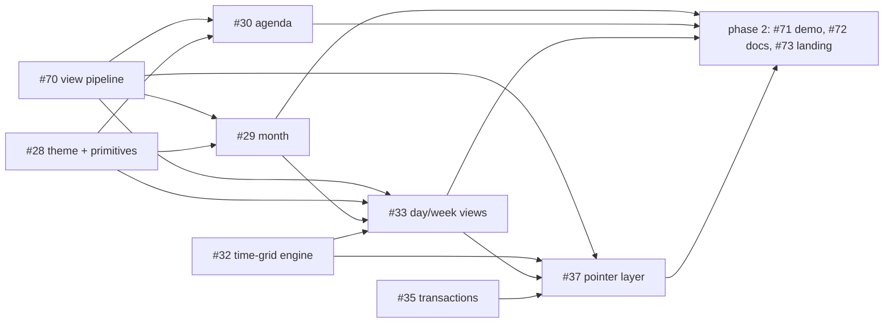

# Moltenship Time — Implementation Plan

> **Roadmap:** [#1](https://github.com/Moltenship/time/issues/1)
> **Design reference:** [architecture.md](./architecture.md)
> **Live status:** GitHub issues, milestones and "blocked by" links

Time is a Temporal-native React calendar: headless engines published to npm, editable views
shipped as shadcn-style registry source. This file is the short map. Issues hold the details.

## Done

| Area           | Issues           | What exists                                                                                                  |
| -------------- | ---------------- | ------------------------------------------------------------------------------------------------------------ |
| Foundation     | #12–#16, #18–#20 | Package topology, contracts and ADRs, fixtures and benchmark harness, SSR fixture, CI, risk spikes           |
| Engine         | #21–#24          | `calendar-temporal` intervals, zoned days, slots and DST; `calendar-core` snapshots and interval indexes     |
| Headless React | #25–#27          | `calendar-react` per-instance store, controlled state, SSR snapshots, typed factory, custom views            |
| Docs platform  | #68              | Fumadocs + Next.js site in `apps/showcase`                                                                   |

No visible views exist yet.

## Now: 0.1 — Working calendar

Goal: a calendar people can use. Month, week, day and agenda views, navigation, create / move /
resize / edit, a demo app, and docs that teach it.
Milestone: [0.1 — Working calendar](https://github.com/Moltenship/time/milestone/6).

| Thread | Issues                | Scope                                                                                                     |
| ------ | --------------------- | --------------------------------------------------------------------------------------------------------- |
| W1     | #70                   | View contract and projection pipeline in React, React bug fixes, facade exports                           |
| W2     | #29, #30              | Month and agenda: projection, fragments, day-grid lane packing, `month-view` and `list-view`              |
| W3     | #32, #33              | Time grid: Temporal snapping, DST-safe geometry, overlap layout, day and week `time-grid-view`            |
| W4     | #28, #71              | Theme tokens and shared shell primitives in `registry/`; Google Calendar-style demo in `apps/demo`        |
| W5     | #35, #37, part of #36 | Transactions, policies, optimistic overlay; native Pointer Events move/resize/create in `calendar-dnd`    |
| W6     | #72                   | Docs content and information architecture                                                                 |
| W7     | #73                   | Docs visual design and landing page with a live calendar                                                  |

### Order

The edges are merge order, matching native "blocked by" links; work can start in parallel. #33
reuses the day-grid lane packing from #29 for its all-day row. Engine work (#32, #35) and phase 1
of #71, #72 and #73 (layout, content rewrite, design system) run in parallel with #70 and #28.
Phase 2 of those three wires in the real views and interactions once they merge.

### 0.1 is done when

- `apps/demo` shows month, week, day and agenda views of realistic data. Create, edit, move, resize
  and delete work with mouse and touch and persist across reloads.
- The docs have a quick start that runs, a page per view, and a landing page with a live calendar.
- `vp check`, `vp test`, `vp run react:gate`, `vp run ssr:smoke` and `vp run showcase:gate` pass on
  `main`.

## Later

Deferred from 0.1. Each item is listed under "Later" in the issue it came from; open a new issue
when one is picked up.

- List virtualization for large ranges (#30)
- Business hours and availability (#32)
- Equal, compact and stacked overlap policies (#33)
- Keyboard move and resize, explicit actions, announcements (#36)
- Optional dnd-kit adapter (#37)
- Layout and frame budgets, browser matrix, RTL and axe suites

Next milestones:

| Milestone                      | Issues          | Scope                                                                         |
| ------------------------------ | --------------- | ----------------------------------------------------------------------------- |
| 0.2 — Keyboard & accessibility | #36             | Pointer-free interaction and announcements, plus picks from the list above    |
| 0.3 — Resource views           | #39–#42         | Resource hierarchy and projections, resource columns, resource timeline       |
| 1.0 — Public release           | #43, #45–#47    | shadcn registry distribution, testing package, release automation, audit      |
| Post-1.0 — Recurrence          | #48, #49        | Range-bounded recurrence, exceptions, detached occurrences                    |

Issues in these milestones still carry their original, heavier scope. Rescope each one to
Scope / Done when / Later before starting it.

## How we work

- One issue → one branch → one PR with `Closes #N`. Issues with two phases (#71–#73) use one PR
  per phase; the last one closes the issue.
- The issue's "Done when" list is the acceptance check. There are no separate gate issues and no
  evidence attachments.
- Run `vp check` and `vp test` before pushing, plus any `vp run` gate the change touches.
- Pullfrog reviews every PR. Fix each comment, or reply in its thread with the reason you didn't.
- Merge with squash once Pullfrog approves and CI is green. Rebase on `main` first if behind.
- Keep native "blocked by" links and this file current when scope or order changes.

## Boundaries

- External events stay the source of truth. The calendar proposes changes; the app commits them.
- `calendar-core` and `calendar-temporal` stay free of React and the DOM.
- Native Temporal only, no `Date` fallback.
- Fumadocs and Next.js stay inside `apps/showcase`. `apps/demo` and the docs import only public
  package entry points and `registry/` source.
- If a PR changes a decision recorded in `architecture.md`, update that file in the same PR.

## Exceptions to `architecture.md` in 0.1

`architecture.md` is still the design reference, except for three decisions this rescope changes.
#37 updates `architecture.md` (§11 and §26) and marks
[ADR 0001](./docs/adr/0001-semantic-dnd-kit-adapter.md) superseded in its PR.

- Pointer input in #37 uses native Pointer Events. dnd-kit becomes an optional adapter for later;
  the #19 spike stays as history.
- Keyboard grab / move / resize comes in 0.2 (#36). In 0.1, pointer changes have equivalents
  through the transaction API (#35) and the demo's event dialog (#71), but no keyboard mode.
- The "performance, accessibility, and browser evidence" invariant is replaced by each issue's
  "Done when" list.
