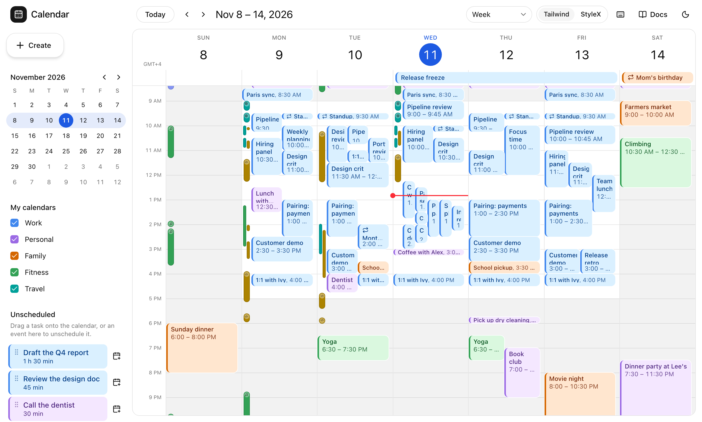

<h1 align="center">
  <a href="https://time.molten.sh">
    <picture>
      <source media="(prefers-color-scheme: dark)" srcset="./.github/assets/wordmark-dark.svg">
      
    </picture>
  </a>
</h1>

<p align="center">
  A React 19 calendar built on the Temporal API, with views you copy into your app and own.
</p>

<p align="center">
  <a href="https://www.npmjs.com/package/@moltenship/calendar"></a>
  <a href="https://github.com/Moltenship/time/actions/workflows/ci.yml"></a>
  <a href="./LICENSE"></a>
</p>

<p align="center">
  <a href="https://time.molten.sh/docs"><b>Documentation</b></a> ·
  <a href="https://time.molten.sh/docs/quick-start">Quick start</a> ·
  <a href="https://moltenship-time-demo.vercel.app">Live demo</a> ·
  <a href="https://github.com/Moltenship/time/releases">Releases</a>
</p>

<p align="center">
  <a href="https://moltenship-time-demo.vercel.app">
    <picture>
      <source media="(prefers-color-scheme: dark)" srcset="./.github/assets/demo-dark.png">
      
    </picture>
  </a>
</p>

Time handles dates, time zones, navigation, calendar state, fast event lookups, and saving changes.
Your events stay in the shape your app already uses, and Time reads them through a small adapter.
The screenshot is the [live demo](https://moltenship-time-demo.vercel.app), a Google Calendar-style
app built from the same views. Its source is in [`apps/demo`](./apps/demo).

> [!NOTE]
> The packages are on npm as a release candidate for 1.0.0. The API can still change before 1.0.0
> if the release candidate turns up problems.

## Features

- **Temporal, not `Date`.** Timed events use `Temporal.Instant`, all-day events use
  `Temporal.PlainDate`, and floating events use `Temporal.PlainDateTime`.
- **Time zones and daylight saving time.** Time lays out days that are 23 or 25 hours long, and
  hours that a clock change skips or repeats.
- **Your event shape.** An adapter tells Time how to read an ID, a title and a time range from your
  records. TypeScript keeps your record and ID types.
- **Views you own.** Week, day, month, year, agenda, resource columns and resource timeline are
  shadcn/ui source files. The shadcn CLI copies them into your app, in Tailwind CSS or StyleX.
- **Editing.** People drag, resize and create events with a mouse, a pen or touch. Each edit
  arrives as a change for you to save. It shows as pending while it saves and rolls back if saving
  fails.
- **Controlled or uncontrolled state.** The calendar or your app can own the visible date, the
  view, the time zone, the selection and the focus.
- **Server rendering.** During server rendering, Time doesn't read the clock, the host time zone or
  `window`, so the server and the browser render the same markup from the same props.
- **Recurrence and iCalendar.** Separate packages expand RRULE series inside the visible range and
  parse ICS feeds.

[Comparison](https://time.molten.sh/docs/comparison) sets Time beside FullCalendar and
react-big-calendar, including where they're ahead.

## Install

```bash
pnpm add @moltenship/calendar react react-dom
```

Time needs:

- React 19.
- A runtime with `Temporal`. Node.js 26 and later include it. In a browser without it, load a
  polyfill before the calendar. Time never bundles one.
- TypeScript 6 or later with `"lib": ["DOM", "DOM.Iterable", "ESNext"]`.

[Installation](https://time.molten.sh/docs/installation) covers the polyfill and the TypeScript
setup.

## Quick start

The smallest calendar, with a hand-written view:

```tsx
import {
  createCalendar,
  defineCalendarView,
  defineEventAdapter,
  plainDateInterval,
} from "@moltenship/calendar";

interface Meeting {
  id: string;
  title: string;
  start: Temporal.Instant;
  end: Temporal.Instant;
}

const eventAdapter = defineEventAdapter<Meeting>()({
  getId: (meeting) => meeting.id,
  getTitle: (meeting) => meeting.title,
  getInterval: (meeting) => ({ kind: "timed", start: meeting.start, end: meeting.end }),
  getResourceIds: () => [],
});

// A minimal view: the meetings on the visible day.
const dayView = defineCalendarView({
  name: "day",
  strategy: {
    getRange: (date) => plainDateInterval(date, date.add({ days: 1 })),
    navigate: (date, delta) => date.add({ days: delta }),
    getTitle: (range, { locale }) => range.start.toLocaleString(locale, { dateStyle: "full" }),
    project: ({ snapshot, instantRange }) => snapshot.queryTimed(instantRange),
  },
  Renderer: ({ projection }) => (
    <ul>
      {projection.map((meeting) => (
        <li key={meeting.id}>{meeting.title}</li>
      ))}
    </ul>
  ),
});

const Calendar = createCalendar<Meeting>()({ eventAdapter, views: [dayView] });

export function MeetingCalendar({ meetings }: { meetings: readonly Meeting[] }) {
  return (
    <Calendar.Root
      events={meetings}
      defaultAnchorDate={Temporal.PlainDate.from("2026-10-08")}
      defaultTimeZone="Europe/Berlin"
      locale="en-US"
      weekRules={{ firstDay: 1, minimalDays: 4, weekend: [6, 7] }}
    >
      <Calendar.PreviousTrigger>Previous</Calendar.PreviousTrigger>
      <Calendar.Title />
      <Calendar.NextTrigger>Next</Calendar.NextTrigger>
      <Calendar.ActiveView />
    </Calendar.Root>
  );
}
```

### Add the built-in views

The styled views aren't in the npm package. Add the week and day, month, and agenda views with the
shadcn CLI:

```bash
npx shadcn@latest add \
  https://time.molten.sh/r/time-grid-view.json \
  https://time.molten.sh/r/month-view.json \
  https://time.molten.sh/r/list-view.json
```

The files land in `components/calendar/`, along with the theme, the toolbar and the view switcher.
The [Quick start](https://time.molten.sh/docs/quick-start) wires them into `createCalendar`.

## Packages

Most apps import `@moltenship/calendar` alone. It re-exports the React, pointer-interaction, core
and Temporal packages.

| Package | What it does |
| --- | --- |
| [`@moltenship/calendar`](./packages/calendar) | The package you install: React components and hooks, the event engine, Temporal helpers and pointer interactions. |
| [`@moltenship/calendar-recurrence`](./packages/calendar-recurrence) | RRULE expansion inside a range, exceptions and series edits. |
| [`@moltenship/ics`](./packages/ics) | Typed iCalendar (RFC 5545) parsing into Temporal values, with Standard Schema support. |
| [`@moltenship/calendar-dnd-kit`](./packages/calendar-dnd-kit) | A dnd-kit adapter: drag your own items into the calendar and events out. |
| [`@moltenship/calendar-testing`](./packages/calendar-testing) | Test helpers: a deterministic environment, builders and fixtures, a render harness, and keyboard and pointer drivers. |
| [`@moltenship/calendar-react`](./packages/calendar-react) | The headless React components and hooks. |
| [`@moltenship/calendar-dnd`](./packages/calendar-dnd) | Pointer drag, resize and create interactions for views. |
| [`@moltenship/calendar-core`](./packages/calendar-core) | The framework-independent engine: event data, projection, layout and interactions. |
| [`@moltenship/calendar-temporal`](./packages/calendar-temporal) | Framework-independent Temporal utilities. |

## Documentation

The docs are at **[time.molten.sh](https://time.molten.sh/docs)**. Good places to start:

- [Quick start](https://time.molten.sh/docs/quick-start)
- [Events and adapters](https://time.molten.sh/docs/concepts/events)
- [Interactions](https://time.molten.sh/docs/interactions)
- [Theming](https://time.molten.sh/docs/theming)

To work on the docs, run `vp run dev` and edit the MDX in
[`apps/showcase/content/docs`](./apps/showcase/content/docs). Start the demo with
`vp run demo#dev`.

## Contributing

The repository uses the [Vite+](https://viteplus.dev/guide/) toolchain (`vp`) and Node.js 26.

```bash
vp install         # install dependencies
vp check           # format, lint, and type-check
vp test            # run the tests
vp run ready       # everything CI runs
vp run ready:full  # the release gate
```

- [`architecture.md`](./architecture.md) is the design the project is building toward.
- [`docs/adr`](./docs/adr) records individual design decisions.
- [`docs/internal`](./docs/internal) has contributor notes: quality gates, package layout and
  releasing.
- Planned work is tracked in [GitHub issues](https://github.com/Moltenship/time/issues).
- Each release's notes are on [GitHub Releases](https://github.com/Moltenship/time/releases);
  [`CHANGELOG.md`](./CHANGELOG.md) has `1.0.0-rc.1`'s.

## License

[MIT](./LICENSE). `@moltenship/ics` also bundles Unicode CLDR data under the Unicode License v3, so
it's `MIT AND Unicode-3.0`; see its
[THIRD-PARTY-NOTICES.md](./packages/ics/THIRD-PARTY-NOTICES.md).
