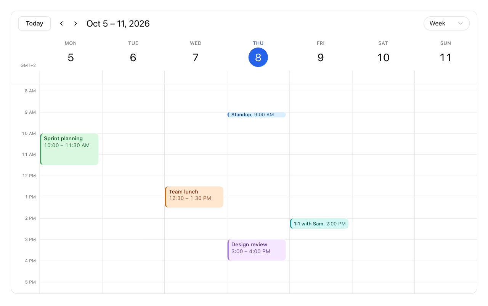

You'll build this calendar: a toolbar, a view switcher, and the built-in week, day, month, and
agenda views, showing your own meetings.



To see these views running with more data before you start, open the [live demo](https://moltenship-time-demo.vercel.app).

<Steps>
<Step>

### Install

Install `@moltenship/calendar` as described in [Installation](/docs/installation), including
`Temporal` if your browsers need it.

</Step>
<Step>

### Copy the UI source

The views are source files that you copy into your app. They're built on shadcn/ui, and are being
updated for its default Base UI primitives; see the note in
[UI source](/docs/installation#ui-source-optional). Add the primitives they use:

```bash
npx shadcn@latest add button popover select tooltip
```

Then copy these folders from the repository's `registry`, and change their `@registry/…` imports
to your own paths, as [UI source](/docs/installation#ui-source-optional) describes:

| Folder           | Copy to                               | Contains                            |
| ---------------- | ------------------------------------- | ----------------------------------- |
| `calendar-theme` | `styles/`, `components/calendar/`     | The theme CSS and event color names |
| `calendar`       | `components/calendar/`                | Toolbar, view switcher, event chip  |
| `time-grid-view` | `components/calendar/time-grid-view/` | Week and day views                  |
| `month-view`     | `components/calendar/month-view/`     | Month view                          |
| `list-view`      | `components/calendar/list-view/`      | Agenda view                         |

Import `calendar-theme.css` in your global CSS, after the Tailwind and shadcn imports.

</Step>
<Step>

### Create the calendar

Describe your records with an adapter, then create a calendar with the views you want. The first
view in the list is shown first.

<include meta='title="calendar.tsx"'>../examples/quick-start.tsx#calendar</include>

`getEventColor` picks each event's color from the [palette](/docs/theming#event-colors).
`dayView: "day"` makes the dates in the week header open the day view.

</Step>
<Step>

### Render it

`Root` holds the calendar state. It needs your events, a starting date, a time zone, a locale, and
week rules (the first day of the week, where 1 is Monday, and the weekend days).
`CalendarToolbar` adds the Today, previous, and next buttons and the title, and the registry's
`ViewSwitcher` switches between your views.

<include meta='title="calendar.tsx"'>../examples/quick-start.tsx#root</include>

Give the frame a height: the views fill it and scroll inside it. The calendar is read-only until
you add an `onEventChange` handler; [Interactions](/docs/interactions) shows how to save dragged and
resized events.

The toolbar's buttons use shadcn's `Tooltip`, which needs a `TooltipProvider` above it. If your app
doesn't have one yet, add it once around your app:

```tsx title="app.tsx"
import { TooltipProvider } from "@/components/ui/tooltip";

<TooltipProvider>
  <TeamCalendar meetings={meetings} />
</TooltipProvider>;
```

</Step>
</Steps>

<Callout title="Using Next.js?">
  Calendar modules are Client Components, which is why the file starts with `"use client"`. See
  [Next.js and server rendering](/docs/guides/nextjs) for passing data from a Server Component.
</Callout>

## Next steps

<Cards>
  <Card
    title="Interactions"
    href="/docs/interactions"
    description="Let people move, resize, create, and delete events."
  />
  <Card title="Views" href="/docs/views" description="Options for each built-in view." />
  <Card title="Theming" href="/docs/theming" description="Colors, dark mode, and event colors." />
</Cards>
