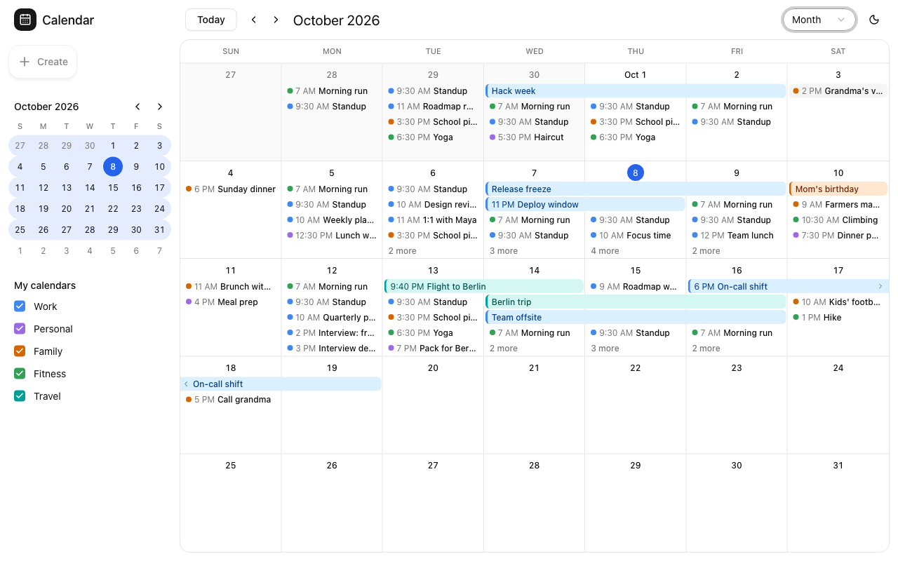

Try it in the [live demo](https://moltenship-time-demo.vercel.app): pick Month in the view switcher.

`createMonthView` shows every week that touches the month, starting on `weekRules.firstDay`. Most
months need five rows; some need four or six.

## Add it

Copy `registry/month-view` into your app (it uses shadcn's `popover`), along with the theme and
`registry/calendar`, as described in [UI source](/docs/installation#ui-source-optional). Then
register the view:

```tsx
import { createMonthView } from "@/components/calendar/month-view/month-view";

export const Calendar = createCalendar<Meeting>()({
  eventAdapter,
  views: [createMonthView<Meeting>({ getEventColor: (meeting) => meeting.color })],
});
```

The view is named `month`. Previous and Next move by one month.

## Options

<TypeTable
  type={{
    getEventColor: {
      type: "(event: TEvent) => CalendarEventColor",
      description: (
        <>
          The color for each event. See <a href="/docs/theming#event-colors">event colors</a>.
        </>
      ),
    },
  }}
/>

## What it shows

- **Days:** weekday names across the top. Days outside the month are muted, today's date sits in a
  filled circle, and the first of each month reads "Oct 1".
- **Multi-day and all-day events** are bars across the days they cover. A bar that continues into
  the previous or next week ends with a chevron. Timed bars start with their start time.
- **Single-day timed events** show a colored dot, the start time, and the title. On narrow screens
  they become small tinted blocks.
- **"+N more":** rows grow to fill the available height, at least 80px each, and show as many
  events as fit. The rest collapse into "+N more", which opens a popover with the day's events.
- **Clicking a date number** opens that day in the view named `day`. Register a
  [day view](/docs/views/week-and-day) so the click has somewhere to go.
- **Editing:** with `onEventChange` on `Root`, drag an event to another day (timed events keep their
  time), and drag across days to create an all-day event. See
  [Interactions](/docs/interactions#drag-resize-and-create).
- **Changes being saved:** events with a [pending change](/docs/interactions#pending-changes) get
  `aria-busy` and render at 60% opacity.

## Markup for interactions

The view connects the pointer layer for you. If you change its markup, keep the attributes it reads:
each day cell has `data-date`, and each event is a `<button>` with `data-event-id`. Event bars sit
on a layer above the cells that lets the pointer through everywhere except on events, so a drag can
find the day under a bar.
