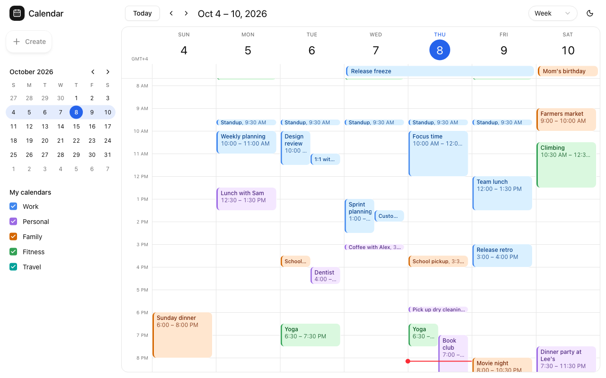
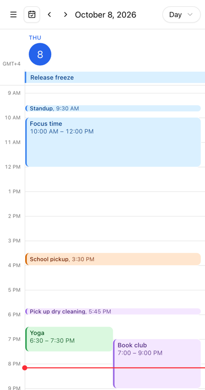

Try both views in the [live demo](https://moltenship-time-demo.vercel.app).

`createWeekView` and `createDayView` show the hours of the day down the side and one column per day.
The week view has seven columns, starting on `weekRules.firstDay`. The day view has one column for
the anchor date.

## Add them

Copy `registry/time-grid-view` into your app (it uses shadcn's `button`), along with the theme and
`registry/calendar`, as described in [UI source](/docs/installation#ui-source-optional). Then
register the views:

```tsx
import { createDayView, createWeekView } from "@/components/calendar/time-grid-view/time-grid-view";

const getEventColor = (meeting: Meeting) => meeting.color;

export const Calendar = createCalendar<Meeting>()({
  eventAdapter,
  views: [
    createWeekView<Meeting>({ dayView: "day", getEventColor }),
    createDayView<Meeting>({ getEventColor }),
  ],
});
```

The views are named `week` and `day`. Pass your event type, as in `createWeekView<Meeting>`, so
`getEventColor` receives your records.

## Options

<TypeTable
  type={{
    dayView: {
      type: "string",
      description: (
        <>
          A registered view that opens when you click a date in the header, usually{" "}
          <code>"day"</code>. Without it the header dates are plain text.
        </>
      ),
    },
    getEventColor: {
      type: "(event: TEvent) => CalendarEventColor | undefined",
      description: (
        <>
          The color for each event. See <a href="/docs/theming#event-colors">event colors</a>.
        </>
      ),
    },
  }}
/>

Set options when you create the view, or per calendar with
`viewOptions={{ week: { dayView: "day" } }}` on `Root`.

## What it shows

- **Header:** the weekday and date of each column, with today highlighted and marked
  `aria-current="date"`. The corner shows the time zone's offset, such as "GMT+2".
- **All-day row:** all-day events, plus timed and floating events that last 24 hours or more. Busy days collapse
  to three rows with "+N more", and a chevron in the corner expands the row.
- **Hours:** labels come from `Intl`, so they read "1 PM" or "13:00" depending on the locale. Each hour
  is `--calendar-hour-height` tall (3rem by default).
- **Events:** overlapping events sit side by side. Events shorter than 45 minutes show on one line,
  as "Standup, 9:30 AM". Events that run past midnight show their real times on both days, as
  "10:00 PM – 2:00 AM".
- **Daylight saving time:** hours skipped when the clocks go forward are hatched, and hours repeated
  when they go back are tinted, with both occurrences side by side.
- **Current time:** a line across today's column, from [`useNow()`](/docs/concepts/time#the-current-time).
  The grid opens scrolled to the current time, or to 08:00 when today isn't visible, and keeps its
  scroll position when you move between weeks.
- **Editing:** with `onEventChange` on `Root`, drag an event to move it (onto the all-day row to
  make it all-day), drag its top or bottom edge to resize it, and drag across empty time or all-day
  cells to create one. See [Interactions](/docs/interactions#drag-resize-and-create).
- **Changes being saved:** events with a [pending change](/docs/interactions#pending-changes) get
  `data-pending` and render at 60% opacity.

The day view works on narrow screens:



## Markup for interactions

The view connects the pointer layer for you. If you change its markup, keep the attributes the
pointer layer reads: day columns have `data-date` and cover the full 24 hours, all-day cells have
`data-date` and `data-all-day`, each event is a `<button>` with `data-event-id`, and events you can
edit have `data-resize="start"` and `data-resize="end"` handles.
